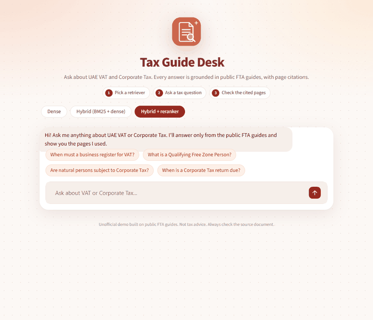
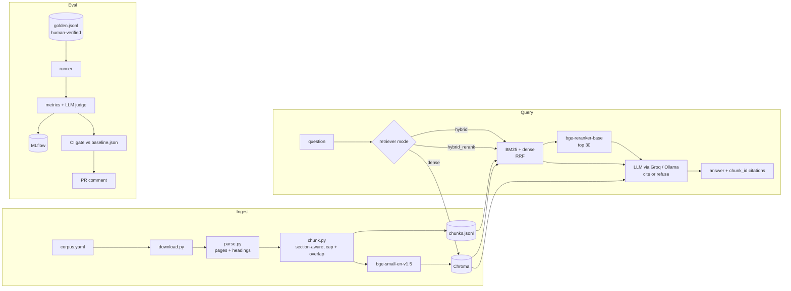

# uae-regulatory-rag



<sub>Live answers from the running app: two cited answers, then a refusal for an out-of-scope question. Re-record with `make demo`.</sub>

**Evaluation-first RAG over public UAE tax guides: every answer cites the page it came from, and a CI gate blocks any change that makes retrieval or faithfulness worse.**

> Status: **Stage 1 (evaluation-first RAG)** built. Stage 2 (agentic routing) and Stage 3 (production + observability) are planned.

## Architecture



## Results

All tables are empty until real eval runs fill them in. No number in this README is estimated.

### Stage 1: retriever comparison (full golden set)

| Retriever | Recall@5 | MRR | Faithfulness | Correctness | Refusal acc. | False refusal ↓ | Citation acc. |
|---|---|---|---|---|---|---|---|
| dense | | | | | | | |
| hybrid (BM25 + dense, RRF) | | | | | | | |
| hybrid + reranker | | | | | | | |

Per-category tables (easy / multi_section / unanswerable) are written to `eval/runs/<run>/results.md`.

### Stage 1: judge calibration (30 human-labelled answers)

| Metric | n | Agreement | Cohen's κ |
|---|---|---|---|
| Faithfulness | | | |
| Correctness | | | |

### Stage 2 / Stage 3

Not built yet.

## How to run

**Runs on: CPU, 8 GB RAM (tested on an i5-1135G7 laptop), no GPU. One free Groq API key, or no key at all with local Ollama.**

```bash
make setup                 # venv + pinned deps (Windows: venv goes to %USERPROFILE%\.venvs)
cp .env.example .env       # add GROQ_API_KEY (free at console.groq.com/keys)
make download              # 7 FTA PDFs -> data/raw/
make ingest                # parse, chunk, embed -> data/chroma
make ui                    # chat UI on http://localhost:8501
make ask Q="What is a Qualifying Free Zone Person?"
```

Build and check the golden set, then evaluate:

```bash
make draft-golden          # LLM drafts ~120 questions -> eval/golden.jsonl (status: pending)
make verify-golden         # you approve / edit / reject each one
make eval-fast             # recall@5 + MRR for all three retrievers, no LLM calls
make eval                  # full metrics incl. LLM judge, logged to MLflow
make mlflow                # browse runs on http://localhost:5000
make calibrate-label ITEMS=eval/runs/<run>/items_hybrid_rerank.jsonl
make calibrate-report ITEMS=eval/runs/<run>/items_hybrid_rerank.jsonl
```

Release gate:

```bash
make ci-subset             # 15 stratified approved items -> eval/golden_ci.jsonl (commit it)
make baseline              # eval on that subset -> eval/baseline.json (commit it)
```

Add `GROQ_API_KEY` as a repository secret. Every PR then runs the subset, compares it with `eval/baseline.json` using thresholds in `config/gate.yaml`, and posts a per-category table as a PR comment.

**Docker:** `docker compose up` (Groq) or `docker compose --profile ollama up` with `UAE_RAG_LLM_PROVIDER=ollama` (fully offline).

### Cost

Everything is free. Embeddings, reranking and the vector store run locally. Groq's free tier is rate-limited (the client spaces requests to `requests_per_minute` in `config/settings.yaml`), so a full eval of ~100 items × 3 retrievers with judging takes a while. Use `--limit` or `--modes` to run less. Switch to Ollama to avoid any account.

## Corpus and terms of use

Public English guides from the UAE Federal Tax Authority, listed in [`corpus.yaml`](corpus.yaml):

- [Taxable Person Guide for VAT (2018)](https://tax.gov.ae/-/media/Files/EN/PDF/Guides/Taxable-Person-Guide-June-2018.pdf)
- [Designated Zones VAT Guide](https://tax.gov.ae/DataFolder/Files/Pdf/Designated-Zones-VAT-Guide.pdf)
- [E-Commerce VAT Guide (2020)](https://tax.gov.ae/DownloadOpenTextFile?fileUrl=en%2FVAT_VAT_Guides%2FE_Commerce%2FE_Commerce_VAT+Guide_EN_09_08_2020_EN.pdf)
- [Corporate Tax General Guide (2023)](https://tax.gov.ae/DataFolder/Files/Guides/CT/CT%20General%20Guide%20-%20EN%20-%2010%2009%202023.pdf)
- [Free Zone Persons Corporate Tax Guide (2024)](https://tax.gov.ae/Datafolder/Files/Guides/CT/Free%20Zone%20Persons%20-%2020%2005%202024%20final%20for%20GCD.pdf)
- [Taxation of Natural Persons Corporate Tax Guide (2023)](https://tax.gov.ae/Datafolder/Files/Guides/CT/Taxation%20of%20natural%20persons%20-%2025%2011%202023.pdf)
- [Tax Returns Corporate Tax Guide (2024)](https://www.tax.gov.ae/Datafolder/Files/Guides/CT/CT-Returns-EN-11-11-2024.pdf)

**Check the FTA's terms of use before redistributing any of this content.** This repo stores only the URLs; the PDFs are downloaded to your machine and never committed. Some guides are older and may not reflect current law. This is a portfolio project, not tax advice.

To use another corpus (ADGM/DIFC rules, port documents), edit `corpus.yaml` and re-run `make download ingest`. Then re-draft the golden set (see limitations).

## Limitations and where it fails

- **Heading detection is heuristic.** It relies on font size and bold lines. PDFs with flat styling get coarse sections, and tables are flattened into text. Bold table header rows ("Where | Then …") can become small sections of their own.
- **Footnotes are dropped.** They split body sentences when extracted, but they carry legal references, which are therefore not searchable.
- **The reranker is slow on CPU.** Scoring 30 passages with bge-reranker-base took about 26 s per question on the i5 dev laptop, compared with well under a second for hybrid retrieval. Stage 3's adaptive reranking targets this.
- **Golden chunk ids are tied to the chunking config.** Changing `chunking` in `settings.yaml` changes chunk ids, so recall/MRR against an old golden set becomes meaningless. Re-draft or re-map after re-chunking.
- **LLM-drafted questions echo the source wording.** This can flatter BM25. Editing questions into natural phrasing during review reduces the bias.
- **The judge is an LLM.** Faithfulness and correctness are only as trustworthy as the calibration table shows. Read κ before trusting small differences.
- **Refusal thresholds are starting values.** `min_rerank_score` needs tuning on a dev split. A threshold that is too high causes false refusals.
- **CI depends on a Groq secret.** PRs from forks can't read it, so the gate is skipped there.
- **Rate limits.** Groq's free tier caps requests and tokens per day. Long evals may pause on HTTP 429 (the client backs off and retries).

## Next steps

- Stage 2: LangGraph agent with query routing across VAT / corporate tax / a second domain, routing eval set, tool-call traces.
- Stage 3: FastAPI service, Redis caching, cost routing, OpenTelemetry + Langfuse + Grafana, load and failure tests.
- Store supporting evidence as text spans so the golden set survives re-chunking.

See [`docs/decisions.md`](docs/decisions.md) for the trade-offs behind each choice.
