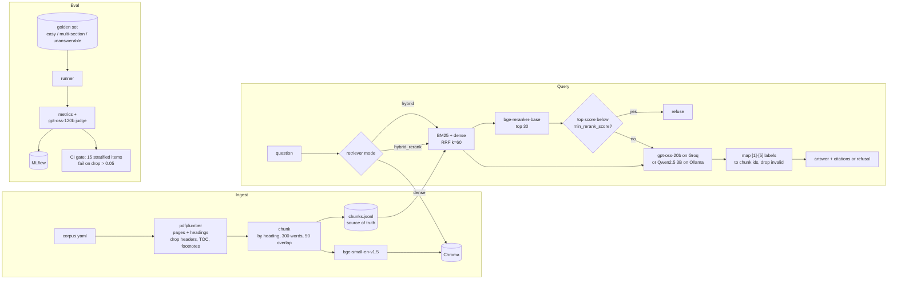

# Architecture and design trade-offs

Cited answers on UAE VAT and corporate tax from 7 public FTA guides (about 650 pages), with refusals for out-of-scope questions and a CI gate that blocks any change that lowers retrieval or faithfulness. Stage 1 is built and runs for $0. The evaluation has not been run yet, so no quality numbers exist.

**Why it exists.** Tax answers are only useful if a reviewer can check them. Every answer cites the page it came from, or the system refuses.

The full decision log is in [decisions.md](decisions.md) (ADR-001 to ADR-013).

## Architecture

The CI gate fails a PR when recall@5 or faithfulness drops by more than 0.05, globally or in any slice with 3+ items.

## Design trade-offs

| Decision | What I chose | What it costs |
|---|---|---|
| LLM | Groq free tier by default, Ollama as the keyless option | Needs a key and is rate-limited; the brief asked for local Qwen 7B, which a 7.6 GB laptop could not run well |
| Structured output | JSON mode + Pydantic validation + one retry with the error | Less strict than provider schema modes, but works the same on every model |
| PDF parser | pdfplumber (MIT) | Slower than PyMuPDF, which is AGPL |
| Citations | Numeric labels mapped to chunk ids in code | One extra mapping step; invented citations are caught instead of trusted |
| Judge | A larger model (120B) than the generator (20B), calibrated on 30 human labels | Calibration is manual work and is not done yet |
| CI gate | 15-item subset | Catches large regressions only, not 1-point changes |

## What failed

- **Empty model replies.** `gpt-oss` reasons before answering, and its hidden reasoning shares `max_tokens`. At 1,024 tokens it sometimes returned nothing, which Groq rejects as HTTP 400. Fixed with `reasoning_effort: low`, 2,048 tokens, and treating that 400 as retryable.
- **Parsing the real PDFs.** Contents entries swallowed whole sections and footnotes split sentences in half. Both are fixed, but dropping footnotes made legal references ("Article 66 of the Corporate Tax Law") unsearchable, and bold table header rows still become tiny sections.
- **The reranker is slow on CPU:** about 26 s per question, against well under 1 s for hybrid.
- **The golden set is fragile.** Gold chunk ids change when chunking settings change, and LLM-drafted questions echo the guide's wording, which flatters BM25.
- **The eval has not been run.** The README results tables are deliberately blank rather than estimated.

## What I'd change

1. Finish the golden set, run the full eval and judge calibration, and publish the numbers.
2. Store gold evidence as text spans, not chunk ids, so the set survives re-chunking.
3. Keep footnotes as chunk metadata so legal references stay searchable; extract tables as tables.
4. Rerank only the top 10, or only when hybrid is unsure, to cut the 26 s cost.
5. Then Stage 2 (LangGraph routing across VAT and corporate tax) and Stage 3 (FastAPI, caching, tracing).
